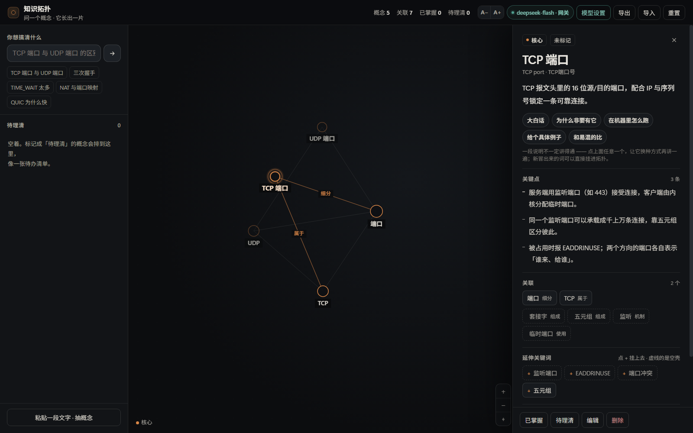

# 知识拓扑 · Knowledge Map

> 读东西时冒出来的专有名词，先收进来，别打断。
> 一个本地单文件的知识图谱：边读边收词，回头逐个弄懂，词与词之间自己连起来。



---

## 它解决什么问题

**不是记不住，是被打断。**

用 AI 或者读一份材料的时候，专有名词是一层层冒出来的：想弄懂 A，解释里出现了 B；去查 B，B 的解释里又套着 C。

这时候只有两条路：

1. 忍着往下读 —— 回头就忘了自己刚才卡在哪；
2. 开个新窗口去查 —— 查完切回来，刚才读到哪一段已经找不到了。

查得越深，窗口开得越多；窗口越多，越回不到正文。**阅读的上下文就是这么断掉的，而且往往再也接不回去。**

这个工具只做一件事：**让你不离开正在读的东西，也能把词收下来。**

- 冒出来的词，先随手扔进这个本地页面占个位。它是**名词收件箱**，不是又一个搜索框
- 有空的时候再逐个补：一句话定义、关键点、换 5 种讲法重讲一遍
- 补过的词在图上自己连起来；下次再遇到同一片区的词，它已经在那儿了
- 单文件、零依赖、纯本地跑。不接模型也能用，那就是一本能长出来的手记

**它追求的不是「查得快」，是「不打断」。** 一个词值得停下来查的时候，你在这一页里就能查完；不值得的时候，扔进去以后再说，正文照读。

---

## 你能做什么

- 输入 `TCP 端口`，给你一张卡（定义 + 关键点 + 关联 + 延伸词）
- 卡上有 **5 个角度**可以再讲一遍：大白话 / 为什么非要有它 / 在机器里怎么跑 / 给个具体例子 / 和易混的比
- 每次讲解都会带出**新的专有名词**，图上还没有的点一下 `+` 就挂进拓扑，并连一条关系
- 挂进来的词如果是空的，**一键补全**会排队把它们全填上
- 认知状态自己标：已掌握 / 待理清；重名的节点会提示**合并成一个**
- 名字起错了可以直接改（改名时老名字自动变成别名，照样搜得到）

单文件、零依赖、零构建。打开就是一个能用的工具，不是一个设计稿。

---

## 快速开始

需要 **Node.js 18+**（只在接模型时用到，页面本身不需要）。

### 方式一：只想离线用（不接模型）

直接双击 `knowledge-map.html`。

内置 50+ 个网络/系统方向的概念，提问、连边、做笔记、导出都能用。**没有 AI**，遇到词库里没有的词只能先挂个空壳。

### 方式二：接上模型（推荐）

```bash
# Windows：双击 启动知识拓扑.bat
# macOS / Linux：
./start.sh
```

会自动起一个**本机网关**并打开 `http://127.0.0.1:8787/`。页面右上角状态胶囊变成绿色的 `deepseek-flash · 网关`，就是接上了。

> ⚠️ 一定要用 `127.0.0.1:8787` 这个地址，别直接双击 HTML 文件。文件里按设计**不含任何密钥**，所以它永远显示「模型未接」。这不是坏了，是故意的。

### 方式三：接别的模型（任意 OpenAI 兼容）

点右上角「模型设置」→ 填接口地址（如 `https://api.openai.com/v1`）、模型名、Key → 「测一下」。

支持任何 `/chat/completions` 形态的服务。如果对方不认 `response_format`，工具会自动去掉它重试一次。

---

## 一次性接入 API（重点）

需求是这样的：**不想每次都去申请 Key，也不想把自己的 Key 写进 HTML 发给别人。**

这件事在 DeepSeek 上没法用「Key 的有效期」解决 —— 它的 Key 是**账户级**的，没有过期时间、没有单 Key 额度、没有权限范围，给出去就等于把整个账户交出去。所以这里换了个做法：**让真 Key 永远不离开你的机器**。

### 原理（三句话）

1. `gateway.js` 起一个只监听 `127.0.0.1` 的小服务，真 Key 只在这个进程的内存里。
2. 页面由这个网关托管。网关在**返回 HTML 的那一刻**，把一枚 **12 小时会话令牌**注入进去。
3. 浏览器后续所有模型请求都带着这个令牌打到网关，网关验证后换成真 Key 转发出去。

于是：**磁盘上的 `knowledge-map.html` 永远只有占位符 `__WB_TOKEN__`**。别人拿到这个文件，里面没有任何密钥，AI 功能自然是关的。

令牌本身以 **SHA-256 哈希**形式落盘，原文不保存，可设有效期、可用次数、可随时吊销。

### 第 1 步：把 Key 放进去（四选一，按顺序生效）

```bash
# A. 环境变量（最通用）
export DEEPSEEK_API_KEY=sk-xxxxxxxx          # Windows: set DEEPSEEK_API_KEY=sk-xxxx

# B. 写在文件里（顺手，但别提交到仓库 —— .gitignore 已经挡掉了）
echo 'sk-xxxxxxxx' > deepseek.key

# C. 结构化（想同时指定地址和模型）
cat > wb-credential.json <<'EOF'
{ "base": "https://api.deepseek.com", "key": "sk-xxxxxxxx", "model": "deepseek-flash" }
EOF

# D. 如果你在用 WorkBuddy 桌面端：什么都不用做，它会自动读 ~/.workbuddy/models.json 里配好的那份
```

想先确认识别对不对：

```bash
node gateway.js check
```

输出会告诉你**凭据从哪来、用的哪个模型、Key 打了码、以及一次真实连通测试的结果**。

### 第 2 步：起服务

```bash
node gateway.js --open          # 默认 127.0.0.1:8787，并打开浏览器
node gateway.js --port 8899     # 换端口
node gateway.js --model deepseek-v4-pro   # 换模型
```

打开页面即已授权，**不需要你再填任何东西**。每次刷新自动换一枚新令牌。

### 第 3 步：要给别人用 / 用完收回

```bash
# 发一枚 24 小时、60 次的令牌（对方需要能访问到你这台机器）
node gateway.js issue --hours 24 --uses 60 --label "给张三"

# 看还有哪些有效的
node gateway.js list

# 收回某一枚
node gateway.js revoke 468efa
```

对方在「模型设置 → 本机网关」里填：地址 `http://<你的IP>:8787/v1`，Key 填那串 `wbk-...`。

> ⚠️ 默认只监听 `127.0.0.1`，本机之外连不进来。要让局域网或 Tailscale 用，才需要 `--host 0.0.0.0`。对外开放时**只发短期令牌**，用完就 revoke，别图省事。

### 命令速查

| 命令 | 作用 |
|---|---|
| `node gateway.js` | 起服务（`--open` 顺便开浏览器） |
| `node gateway.js check` | 只检查凭据和连通性，不起服务 |
| `node gateway.js issue --hours 24 --uses 60 --label "给谁"` | 发临时令牌 |
| `node gateway.js list` | 列出所有令牌与状态 |
| `node gateway.js revoke <编号>` | 吊销 |

### 三种接入方式的区别

| 方式 | 密钥存在哪 | 把 HTML 发给别人会怎样 |
|---|---|---|
| 页面里直接填 Key | 你这台浏览器的 localStorage | 不随文件走，对方拿不到；但换台机器要重填 |
| **本机网关** | 只在 node 进程内存 | 对方拿到的是干净文件，AI 自动关闭 |
| 把 Key 写进 HTML 源码 | 文件里 | **等于公开**，千万别这么做 |

---

## 界面速览

| 位置 | 能干什么 |
|---|---|
| 左上输入框 | 敲概念，回车。支持 `A 与 B 的区别`，会自动建对比关系 |
| 右侧面板 | 定义、关键点、关联、延伸关键词、我的笔记 |
| 面板顶部 5 个角度 | 换种方式再讲一遍；带出的词点 `+` 直接入图 |
| 左下「一键补全」 | 把所有空壳排队补完，串行执行、有进度、可中途停 |
| 面板底部 | 已掌握 / 待理清 / 编辑 / 删除（`Delete` 键也行） |
| 名字下方的红条 | 发现同义节点时提示，一键合并 |
| 右上 `A− / A+` | 全局字号（`Ctrl` + `−` / `=`，`Ctrl+0` 复位） |
| 名字旁的画布胶囊 | 切换 / 新建 / 改名 / 删除画布（`Ctrl` / `⌘` + `K`），数字是你这张图上有几个概念 |
| 导出 / 导入 | 导出是**整包**（所有画布一个文件）；导入是**加成新画布**，不覆盖手上这张 |

---

## 命名口径

图上显示的字，按**工程师嘴里真正在说的那个词**来，不按词典直译。这条规则写死在提示词里：

| 情况 | 主名 | 别名 |
|---|---|---|
| 行业缩写 | `IP`、`TCP`、`DNS`、`API`、`JWT` | 英文全称 + 中文全称 |
| 有通行中文词的普通词 | `线程（thread）`、`缓存（cache）` | `thread`、`current` 等原词 |
| 判断不出来的 | 保留你输入的原词 | 模型猜的名字全进别名 |

为什么较真这件事：`IP` 直译成「国际协议」、`current` 直译成「电流」，
这些词在中文技术圈**没人这么说**，翻出来只会让你在图上多认一个假概念。
宁可留英文，也不造一个中国人不说的中文名。

模型还是会偶尔起错名。**改法在「编辑」里第一栏**——直接改名字，
老名字自动降级成别名（以后搜旧名字照样命中）；如果新名字图上已经有了，
它会把两个节点并成一个，不会给你留两个同义的。

---

## 多画布

一个学科一张图，而不是所有东西挤在同一张图上。

理由很实际：把「计算机网络」和「商业地产」塞进同一个拓扑，力导向会硬把它们拉成一团；而且你搜「端口」的时候，永远先想到网络那个，另一个就被永久埋掉了。**混在一起，两边都变模糊。**

所以这么做的：

- **每个画布完全独立** —— 自己的节点、连线、笔记，以及自己的视图位置。切换是整份状态换掉，不是在数据上做过滤
- **名字常驻在顶栏** —— 画布胶囊一直显示你在哪个学科，点开才展开全部。不做标签页：学科一多就挤成一条细线，还放不下概念数、也没法就地改名
- **切回来一模一样** —— 平移缩放、选中的节点、面板滚动位置，全按离开时还原。差一点，人就会怀疑自己记错了
- **删之前问一句，删之后能撤回** —— 二次确认 + 5 秒撤销。最后一个画布不许删（想清空用「重置」）
- **重置只管当前这张** —— 「重置」有两个选项：清空，或回到内置示例。别的画布凭什么陪葬
- **老数据自动升级** —— 现有拓扑会变成第一个画布「我的拓扑」，一个点都不丢；**坐标原样保留，不重排**（你摆的位置是你的空间记忆，不是待优化的中间结果）
- **导出是整包** —— 一个文件装下所有画布。只导当前画布的话，换个浏览器三个学科就只剩一个，那不叫备份

边界也说清楚：**不做跨画布引用**。一个概念只属于一个学科；要串就在两边各建一个，用备注写「另见 数据库系统 · 索引」。一旦允许共享节点，改 A 会动到 B，最后谁也说不清这个概念是谁的。

> 快捷键只做**能可靠拦下**的两个：`Ctrl/⌘+K` 开合切换器、切换器内 `↑↓` 选择 + `Enter` 打开 + `Esc` 关闭。
> 刻意不做 `Ctrl+N` / `Ctrl+1..9` —— 那是浏览器自己占着的键，抢过来只会让「新开一个窗口」变成「多了一个画布」。

---

## 数据与隐私

- 所有数据存在**你自己浏览器的 localStorage**，没有账号、没有服务端、没有遥测。
- 存成两组键：`knowledge.v2.meta`（画布清单）和 `knowledge.v2.cap.<画布id>`（每张画布的内容）。
  早期单画布的 `knowledge.v1` 在迁移后**只读保留**，不再写入 —— 万一迁移出岔子，原数据还在。
- 唯一的网络请求发往**你自己配置的模型接口**。
- 换浏览器、清缓存、隐私模式都会丢数据 —— **定期「导出」**。
- `gateway.js` 不认识你的图，它只做一件事：把请求转发出去。

---

## 目录结构

```
knowledge-map.html     界面 + 图谱引擎（单文件，可直接双击）
gateway.js             本机网关（可选；接模型时用，零依赖）
启动知识拓扑.bat        Windows 双击启动
start.sh               macOS / Linux 启动
docs/preview.png       截图
```

---

## 常见问题

**右上角是红的「模型未接」**
你打开的是文件本体（`file://`），不是网关地址。跑 `node gateway.js --open`，用 `http://127.0.0.1:8787/` 打开。

**提示「网关令牌过期了」**
会话令牌 12 小时。刷新页面即可换新。

**`Error: listen EADDRINUSE`**
端口被占用，`node gateway.js --port 8899`。

**`HTTP 400 model not found`**
模型 id 不对。截至 2026 年 11 月，DeepSeek 实际可用的是 `deepseek-flash` 和 `deepseek-v4-pro`；老教程里的 `deepseek-chat` 已于 **2026-07-24 下线**。

**「没讲成：返回不是合法 JSON」**
模型偶尔会吐出坏 JSON（字符串里混进裸引号、尾逗号）。工具已经内置了修复与一次重试；仍失败就换个模型试试，或再点一次。

**能不能多人共用一份图**
目前数据在各自浏览器里。想共用可以导出 JSON 互相导入，或把它放到内网网关后面（记得发短期令牌）。

---

## English

**The problem isn't forgetting — it's being interrupted.**

Reading docs or working with an AI, every answer spawns new jargon. Explaining A introduces B; explaining B introduces C. You either keep reading and lose your place, or open another tab and lose it anyway. The deeper you dig, the more windows you have, and the further you are from the text you started with.

This is a local, single-file page that catches those terms so you never have to leave what you're reading. Jot a term down and keep going; come back later to explain it properly. Five "explain it another way" angles, batch fill-in, node merge/rename/delete, and a graph that grows itself.

It optimises for *not interrupting you* rather than for answering fast.

To use the model features, run the tiny local gateway (`node gateway.js --open`) — your real API key never leaves the process, and the HTML file itself contains no secrets, so sharing the file is safe. Works with any OpenAI-compatible `/chat/completions` endpoint. A multi-canvas design (one graph per subject, switchable and named) is specified but not yet implemented.

---

## License

[MIT](LICENSE)
